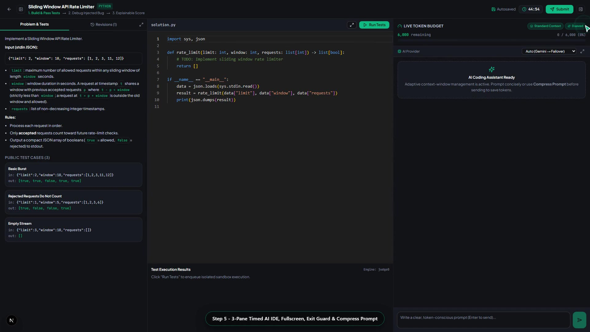
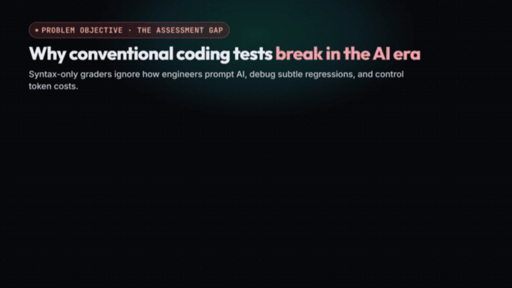

# PromptBench — AI-Assisted Coding Challenge Assessment Platform

An enterprise-grade AI-assisted coding assessment platform built with **Next.js (App Router, TypeScript)**, **Tailwind CSS**, **Supabase (PostgreSQL + JWT Auth + RLS)**, **Judge0 CE**, and **Google Gemini**.

## Live Demo & Submission Deliverables

- **Live Deployed App:** [https://promptbench-beta.vercel.app](https://promptbench-beta.vercel.app)
- **Presentation Deck:** [PromptBench_Designathon_Presentation.pptx](./PromptBench_Designathon_Presentation.pptx)
- **Solution Architecture Abstract (PDF):** [PromptBench_Solution_Architecture_Abstract.pdf](./PromptBench_Solution_Architecture_Abstract.pdf)

### Demo Credentials (Hackathon Evaluation)

Use the dedicated demo accounts below at [https://promptbench-beta.vercel.app/login](https://promptbench-beta.vercel.app/login) to explore all three roles immediately:

| Role | Email | Password |
| :--- | :--- | :--- |
| **Admin** | `admin@promptbench.ai` | `Admin@12345` |
| **Evaluator** *(3 candidates pre-assigned)* | `evaluator@promptbench.ai` | `Evaluator@12345` |
| **Candidate** | `candidate@promptbench.ai` | `Candidate@12345` |

### Product Walkthrough Videos

#### 1. Full End-to-End Walkthrough (1080p with Neural AI Voiceover — 3m 29s)

[](https://github.com/Aamir-Manzoor/Designathon/raw/main/demo-output/promptbench-full-walkthrough.mp4)

> 🎥 **[Click here to watch or download the Full 1080p Walkthrough MP4 (19.5 MB)](https://github.com/Aamir-Manzoor/Designathon/raw/main/demo-output/promptbench-full-walkthrough.mp4)**
> 
> *Full feature tour with Microsoft Neural TTS voiceover (`en-US-GuyNeural`), covering every single capability requested in the problem statement.*

| Timestamp | Chapter | Key Capabilities Demonstrated |
| :--- | :--- | :--- |
| `00:01` | **Landing Page & Navigation** | Five-stage workflow cards, responsive layout, theme switcher in dropdown |
| `00:18` | **Invite-Only Guard & Auth** | Registration request flow, password reset for Candidate & Evaluator |
| `00:30` | **Admin Console & Governance** | Score vs Token efficiency scatter plot, search & date filters, reject/delete applicants, evaluator assignment |
| `00:58` | **Candidate Portal & Sandboxes** | Ungraded Practice Sandbox (hidden from Admin), sealed Official Assessment rules confirmation |
| `01:11` | **3-Pane Timed AI IDE** | Monaco editor, fullscreen Zen mode, expandable panels, anti-cheat external paste block, 1-click **Compress Prompt** |
| `01:32` | **Phase 1 Pass & Bug Injection** | Sandbox code execution, Phase 2 modal transition, deterministic boundary bug injection into candidate code |
| `02:25` | **Session Protection & Profile** | Single-access exam lock, auto-submit confirmation popup on exit, theme switcher hidden in profile |
| `02:36` | **Evaluator Review & One-Time Lock**| 100-pt explainable scorecard (40/10/30/20), one-time Pass/Reject feedback lock preventing re-edits |
| `02:58` | **Admin Report Release & Excel Export** | Gated candidate report release, multi-sheet formatted `.xlsx` download with token analytics |
| `03:16` | **Candidate Final Outcome**| Released candidate feedback view with zero numeric score leakage |

#### 2. Fast-Paced 24-Second Teaser Video (/brag)



> ⚡ **[Watch or download the 24s High-Energy Teaser MP4 (4.7 MB)](https://github.com/Aamir-Manzoor/Designathon/raw/main/brag-output/brag.mp4)** with custom motion typography, beat-synced transitions, and sound effects.

## Minimum Scope Implemented
1. **Challenge Configuration & Launch**: Full Admin console to configure coding challenges, time limits, token budgets, public/hidden/debug test cases, and deterministic bug-injection rules. Pre-seeded with 3 complete challenges (*Sliding Window API Rate Limiter*, *Log Anomaly & Spike Aggregator*, *Deployment Maintenance Window Merger*).
2. **AI-Assisted Coding & Controlled Bug Injection Workflow**:
   - Full email/password JWT authentication with role-based access (`Admin / Evaluator` vs `Candidate`).
   - 3-pane IDE workspace with Monaco Editor, revision history, timed session countdown, debounced autosave, and integrity telemetry (`tab_blur`, `ai_code_applied`, `bug_injected`, `budget_warning`).
   - Isolated code execution via **Judge0 CE** batch API (with automatic local Python/Node fallback when `JUDGE0_API_KEY` is not yet configured).
   - Controlled reproducible bug injection after initial public tests pass, transitioning seamlessly to Phase 2 (Debug & Resubmit).
3. **Explainable 100-Point Scoring Engine**:
   - **Prompt Quality (40)** across 4 criteria with turn citations
   - **Prompt Improvement (10)** across iterative turns
   - **Test Cases (30)** from public + hidden automated execution
   - **Debug Test Cases (20)** from post-bug-injection verification
4. **Token Optimization Engine, Live Visual Meter & Excel Export**:
   - Context-reduction pipeline: reusable system instructions + rolling conversation summary + editor code deduplication.
   - Live Candidate Token Budget Meter showing remaining tokens, burn trend sparkline, real-time **Tokens Saved**, high-consumption warnings (75% / 90%), and pre-send prompt-efficiency hints.
   - Pre-seeded with **5 synthetic candidate sessions** (full prompt histories, token logs, and 100-pt scorecards) + multi-sheet formatted **Excel (`.xlsx`) export**.

## Bonus Capabilities Implemented
- **Configurable Token Budgets & Cost Analytics**: Inline challenge token-budget & time-limit editor in `/admin`, per-candidate USD cost & efficiency index (`Pts / 1K Tok`) in UI and `.xlsx` export, plus a **Correctness vs. Token Efficiency** scatter plot.
- **Adaptive Context-Window Management, Prompt Compression & Multi-Provider AI**: Automatic `Standard → Compact → Ultra-Lean` context tiers as budget depletes, 1-click **Compress Prompt** suggestions with exact token savings preview, and multi-provider routing (`Auto`, `Google Gemini`, `Groq`, `OpenRouter`).
- **Calibrated Rubric Checks, Queue-Based Execution, Concurrency Testing & Automatic Recovery**: Bounded-concurrency FIFO execution queue with automatic retry, `localStorage` + Supabase dual-layer crash/reload draft recovery, 3-anchor rubric calibration verifier, and live parallel concurrency stress test in `/admin` → **Calibration & Queue Ops**.

## Environment Setup
`.env.local` is pre-configured for the connected Supabase project (`dfamjqvblqikjuxplfbb`). Add your **Gemini API Key** (and optionally **Judge0 CE** key) in `.env.local`:

```bash
GEMINI_API_KEY=your-gemini-api-key
GEMINI_MODEL=gemini-3.5-flash-lite

# Optional: Judge0 CE (falls back to local Python/Node runner when empty)
JUDGE0_API_URL=https://judge0-ce.p.rapidapi.com
JUDGE0_API_KEY=
JUDGE0_API_HOST=judge0-ce.p.rapidapi.com
ALLOW_LOCAL_EXECUTOR_FALLBACK=true
```

## Run Locally
```bash
npm install
npm run dev
```
Open `http://localhost:3001` (or visit the live deployment at [https://promptbench-beta.vercel.app](https://promptbench-beta.vercel.app)). Register an **Admin / Evaluator** account to view the 5 pre-seeded candidate scorecards and export `.xlsx`, or register a **Candidate** account to take the live AI-assisted assessment.
